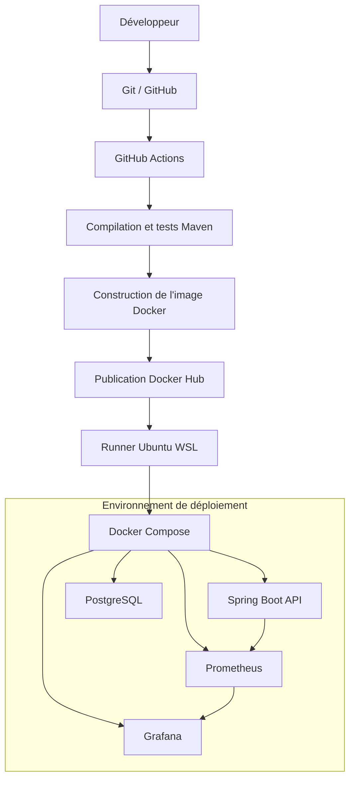
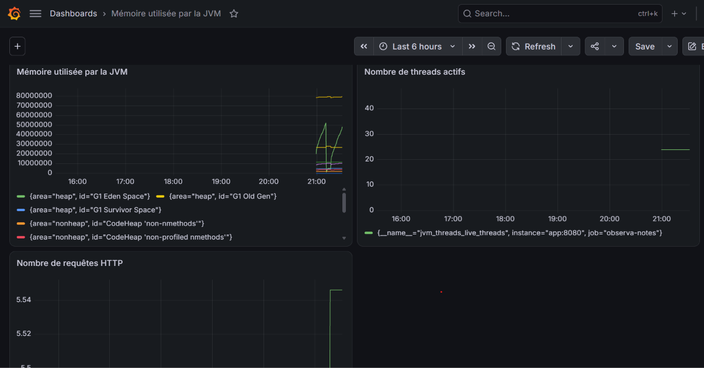

# ObservaNotes — API REST Java avec CI/CD et supervision

**Projet de portfolio DevOps, Cloud et développement logiciel**

ObservaNotes est une application de gestion des étudiants et de leurs résultats scolaires, développée avec Java et Spring Boot. Elle expose ses fonctionnalités à travers une API REST et utilise PostgreSQL pour la persistance des données.

Ce projet met en œuvre une chaîne DevOps complète : développement, tests automatisés, conteneurisation, intégration continue, publication d'images Docker, déploiement automatisé et supervision applicative.

## Architecture

Le pipeline repose sur GitHub Actions pour automatiser la validation et la publication de l'application. Un runner auto-hébergé sous Ubuntu (WSL) assure ensuite le déploiement avec Docker Compose.



### Technologies utilisées

| Domaine | Technologies |
|---|---|
| Langage | Java 25 |
| Framework | Spring Boot |
| API | Spring Web, API REST |
| Persistance | Spring Data JPA, PostgreSQL 17 |
| Tests | JUnit 5, Mockito |
| Build | Maven |
| Versionnement | Git, GitHub |
| Intégration et déploiement continus | GitHub Actions |
| Conteneurisation | Docker, Docker Compose |
| Registre d'images | Docker Hub |
| Environnement de déploiement | Ubuntu sous WSL, self-hosted runner |
| Instrumentation | Spring Boot Actuator, Micrometer |
| Collecte des métriques | Prometheus |
| Visualisation | Grafana |

## Fonctionnalités de l'application

- Gestion des étudiants : création, consultation, modification et suppression.
- Gestion des notes associées aux étudiants.
- Calcul des moyennes.
- Exposition des fonctionnalités à travers une API REST.
- Vérification de l'état de santé de l'application avec Spring Boot Actuator.
- Exposition des métriques applicatives au format Prometheus.

## Pipeline CI/CD

Le workflow GitHub Actions automatise les principales étapes du cycle de livraison :

1. Déclenchement à la suite d'un push ou d'une pull request sur `main`.
2. Configuration de l'environnement Java.
3. Compilation et vérification du projet avec Maven.
4. Exécution des tests automatisés.
5. Construction de l'image Docker.
6. Publication de l'image sur Docker Hub avec les tags `latest` et le hash du commit.
7. Déploiement automatique sur l'environnement Ubuntu via un runner auto-hébergé, après un push sur `main`.

Le déploiement utilise Docker Compose pour récupérer la nouvelle image et mettre à jour les services.

## Conteneurisation et déploiement

L'application et ses services associés sont exécutés dans des conteneurs Docker orchestrés avec Docker Compose.

Les principaux services sont :

- **Application Spring Boot** : expose l'API REST sur le port `8080`.
- **PostgreSQL** : assure la persistance des données.
- **Prometheus** : collecte les métriques de l'application sur le port `9090`.
- **Grafana** : permet de consulter les tableaux de bord sur le port `3000`.

Le premier environnement de déploiement repose sur Ubuntu sous WSL. Le runner auto-hébergé permet à GitHub Actions d'exécuter le déploiement directement dans cet environnement.

### Lancement de l'environnement

Depuis le répertoire racine du projet, créer un fichier `.env` contenant les variables nécessaires à `compose.prod.yaml` :

```env
DOCKERHUB_USERNAME=votre_identifiant_dockerhub
IMAGE_TAG=latest
APP_DB_USERNAME=observa_user
APP_DB_PASSWORD=votre_mot_de_passe
```

Ne jamais publier ce fichier ni y placer de véritables identifiants dans le dépôt Git.

Récupérer les images :

```bash
docker compose -f compose.prod.yaml pull
```

Démarrer les services :

```bash
docker compose -f compose.prod.yaml up -d
```

Vérifier leur état :

```bash
docker compose -f compose.prod.yaml ps
```

Consulter les journaux de l'application :

```bash
docker compose -f compose.prod.yaml logs -f app
```

Arrêter les services sans supprimer les volumes de données :

```bash
docker compose -f compose.prod.yaml down
```

### Accès aux services

| Service | Adresse |
|---|---|
| API Spring Boot | http://localhost:8080 |
| Santé de l'application | http://localhost:8080/actuator/health |
| Métriques Prometheus de Spring Boot | http://localhost:8080/actuator/prometheus |
| Interface Prometheus | http://localhost:9090 |
| Interface Grafana | http://localhost:3000 |

Ces adresses sont accessibles depuis la machine qui héberge les conteneurs.

## Supervision et observabilité

La supervision repose sur Spring Boot Actuator, Micrometer, Prometheus et Grafana.

Micrometer expose les métriques de l'application. Prometheus les collecte périodiquement, puis Grafana les exploite pour construire des tableaux de bord.

Le dashboard ObservaNotes permet notamment de suivre :

- L'utilisation de la mémoire JVM.
- Le nombre de threads actifs.
- Le volume de requêtes HTTP.
- L'évolution de l'activité de l'API.

### Dashboard Grafana



*Tableau de bord de supervision de l'application ObservaNotes.*

## Compétences mises en pratique

Ce projet m'a permis de travailler sur plusieurs domaines complémentaires :

- Développement d'une API REST avec Java et Spring Boot.
- Persistance des données avec PostgreSQL et Spring Data JPA.
- Tests unitaires avec JUnit 5 et Mockito.
- Conteneurisation et orchestration avec Docker et Docker Compose.
- Automatisation d'un pipeline CI/CD avec GitHub Actions.
- Publication d'images Docker sur Docker Hub.
- Déploiement automatisé avec un runner auto-hébergé sous Ubuntu.
- Instrumentation et supervision avec Actuator, Micrometer, Prometheus et Grafana.

## Auteur

**Assane Thiao**  
Élève-ingénieur en Télécommunications et Réseaux  
Sup Galilée – Paris 13

- Portfolio : [assanethiao.github.io](https://assanethiao.github.io)
- LinkedIn : [Assane Thiao](https://www.linkedin.com/in/assane-thiao-54a159278)

---

*Projet réalisé dans le cadre d'un apprentissage pratique du développement logiciel, du DevOps, de la CI/CD, de la conteneurisation et de l'observabilité.*